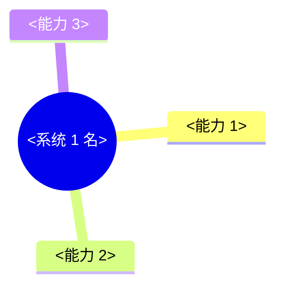
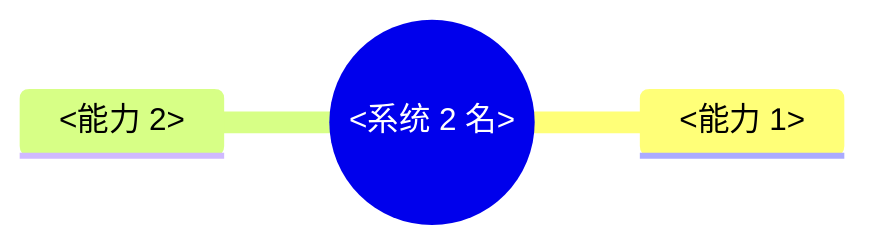
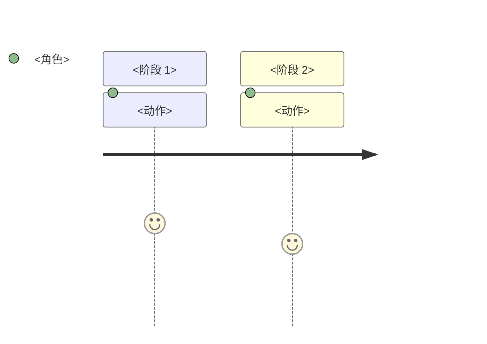
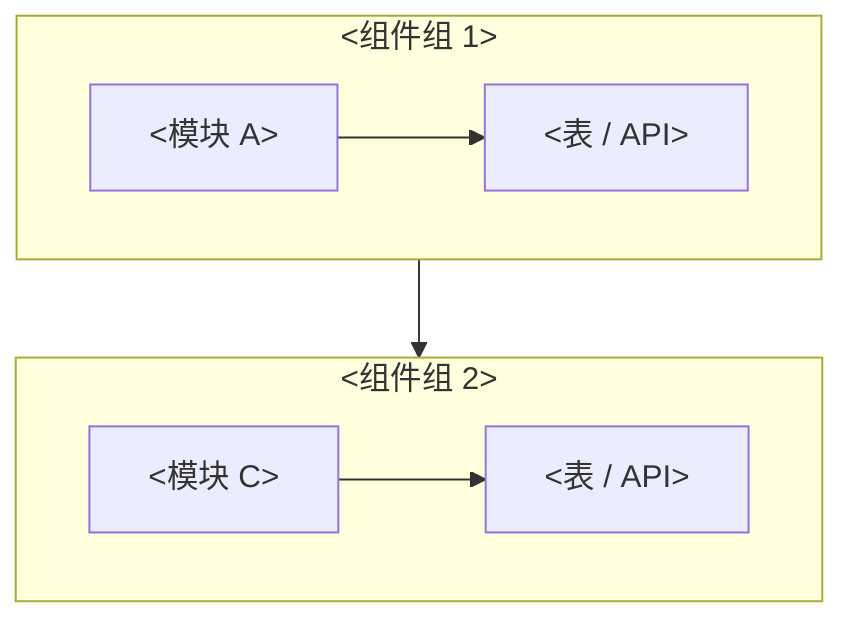

<!--
  系统架构文档 · 纯骨架模板(直接 cp 改用)
  完整 SOP / 维护铁律 / 反例 → 见 `arch-doc-guide.md`
  用法:cp 本文件到项目 `_wiki-methodology/_top/` 下(如 `SYSTEM-ARCH.md`)· 按 <占位> 填
-->

# <项目名> 架构文档(arc42 单文件)

| 真源链接 | 路径 |
|---|---|
| ADR / 系统状态 | `_wiki-methodology/_top/_decisions/` / `_wiki-methodology/_top/_task_plan.md` |
| 风险 / 路线 | `_wiki-methodology/_top/` 下的路线文档 |
| 技术细节深扫 | `_wiki-methodology/_wiki/<topic>` |
| 用户旅程清单 | <项目根>/_wiki-methodology/_tests/trunk-recording/ |

---

## 1. 目标与约束

**3 句话目标**:
1. <系统 1 一句话定位>
2. <系统 2 一句话定位>
3. <系统 N ...>

**硬约束**(写不变 ≤6 条):
- <约束 1>
- <约束 2>

---

## 2. L1 能力图(老板看 · 全人话)

> 每系统一张 mindmap · 启发式 5-9 节点 · 超 11 拆 root

### <系统 1 名>

### <系统 2 名>

---

## 3. L2 用户旅程(测试看 · 横切多域)

> 每个**已 ready** 的用户旅程一张 journey · **不占位**(等真做再画)

### <wfN 旅程名>

<未 ready 的旅程暂不画>

---

## 4. L3 架构图(开发看 · 每箭头指代码/表/API)

> flowchart TB + subgraph · 每 subgraph 节点 ≤ 5

### <系统 1 名>

---

## 5. ADR(决策记录)

完整 → `_wiki-methodology/_top/_decisions/`(单一真源 · 本节不重复)

## 6. 风险与依赖

完整 → `_wiki-methodology/_top/` 路线文档的风险段(单一真源 · 本节不重复)

---

## 维护铁律

→ **真源 = [`arch-doc-guide.md`](arch-doc-guide.md) §5**(违反 = 退回 · 不在本文重复)
